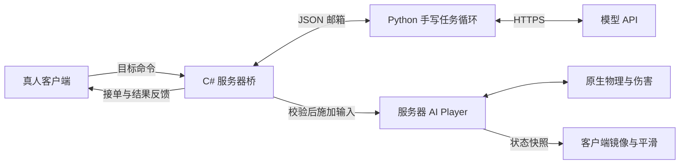

# 当前技术设计与实现

更新于 2026-11-27。本文描述当前职责，验收见 [集中清单](acceptance-checklist.md)。

C# 服务器持有 AI 与游戏事实。Python 读取结构化观察，调用 DeepSeek 选择短动作，C# 按目标身份校验后执行。战斗任务绑定目标 NPC 和武器，固定傀儡命中后停手，蓝史莱姆任务另需退避到位。客户端处理显示与反馈。

`MultiplayerAgentBridge` 负责多人目标邮箱、身份校验、动作白名单及结果过滤；`MultiplayerProbe` 负责真人控制归属、连接对象校验和网络回显；`MultiplayerGoalAcceptance` 仅在显式开发模式下自动驱动替换／停止验收，不参与普通游戏决策。Python 仍复用同一个手写 loop，以模式选择观察、提示词和工具白名单；OS 文件锁保证单邮箱单宿主，单个在途模型请求避免快速替换时积累线程。详见 [多人探针](multiplayer-probe.md)。

## 多人角色与显示

`Commands/MultiplayerProbeCommand.cs` 提供独立 `/tpamp` 命令，经 Mod.HandlePacket 转交 `Common/MultiplayerProbe.cs`。服务器执行生成、限时移动、队伍和清理，每 6 tick 向客户端发送位置／速度／方向／队伍／生命、当前持有物和物品动画；客户端创建显示镜像。服务器对虚拟槽位跳过无连接清理分支，不暂时切换 active；发往该空连接槽位的原生聊天消息被过滤。IL 分支按运行时 ILLabel 处理，模式变化则拒绝加载，需检查新 tML 版本。

当前一名真人场景已通过基础角色、平滑、清理、接触受伤／死亡／重生及中文短目标；AI不是实际网络客户端。第二真人、存活服务器断线和占槽冲突仍待验证。`/tpa` 命令入口仍限单人；JSON 邮箱按模式分工，并非全部只支持单人。命令与证据见 [多人探针](multiplayer-probe.md)。

## 基座与职责

C# 12／.NET 8的独立tModLoader模组负责角色和原生连续控制；Python标准库Agent负责HTTPS模型请求与任务循环。global.json 指定兼容的.NET 8 SDK选择规则，本地配置为`.local/tModLoader`。不依赖第三方伙伴模组、数据库、完整寻路或Agent框架；Cheat Sheet／HERO's Mod 是默认测试辅助。

| 文件 | 当前职责 |
| --- | --- |
| Common/DemoPlayerSystem.cs | 独立Player槽位、生命周期、输入、跨坎／恢复、库存与敌怪观察、战斗事件；同文件DemoUpdateProbe补接触伤害并计更新数 |
| Common/GroundNavigation.cs | 水平目标、home／活动边界、刹停判断、目标状态和sequence；不计算完整路径 |
| Common/LocalTerrain.cs | 局部碰撞探测和17×11格观察 |
| Common/NativeMining.cs | 普通挥动镐原生接入、范围／保护条件、候选、原生PickTile前后事件和取消 |
| Commands/DemoCommand.cs | /tpa参数、单人限制、明确接受或拒绝；操作真人与受控AI分离；`/tpa goal`把目标文本交给宿主邮箱；stop／remove清掉待发目标 |
| Common/LocalTestBridge.cs | -tpatest下的文件请求、停止优先通道、版本检查与状态；`/tpa goal`先RequestStop抢占、按入队时的stopRevision／worldSession发布goal（新目标覆盖待发目标），按id过滤过期结果，并用host-ready心跳判断宿主是否在线；复用命令层，不开网络端口 |
| Common/MultiplayerProbe.cs、DisplaySync.cs | 真人 Player／Socket 控制归属，服务器命令／反馈包、客户端镜像、有界平滑和持有物显示；不复制怪物选敌逻辑 |
| Common/NativeCombat.cs、MultiplayerAttackPolicy.cs、CombatHitProbe.cs | 服务器权威 AI 的铜短剑原生刺击 projectile 与 Iron Broadsword 直接近战适配；手动 `/tpamp attack` 的身份／物品／时长校验；服务端记录原生 projectile／item 命中，不伪造伤害 |
| Common/StartingInventory.cs、StartingKit.cs、HeldItemWire.cs | 服务器按经典三件初始化一次，失败不发布 AI；客户端镜像选中物与原生物品动画状态 |
| Common/NativePlayerInteractions.cs | 只对服务器权威 AI 放行原生 Buff 倒计时、到期清理和掉落入包；使用原生物品包同步地面变化 |
| Common/MultiplayerAgentBridge.cs | 多人目标身份、固定靶绑定、动作校验、原生命中停手和结果优先回送 |
| Common/MultiplayerGoalAcceptance.cs、agent/acceptance.py | 有界开发验收：真实接单后替换、移动开始后停止、观察60tick；不参与普通决策 |
| Common/WorldSession.cs | 世界会话标识；进世界生成、退出清空，恢复对账据此拒绝跨世界恢复 |
| Common/NativeChatInput.cs、EnterDiagnostics.cs | 开发输入诊断及固定聊天探针，不是任意文本输入工具 |
| agent/run.py、agent/prompts/ | 模型工具白名单、顺序等待、实际结果判定、取消、有限预算、报告与能力／目标提示；常驻宿主的心跳线程与目标身份绑定 |
| scripts/ | 构建、独立启动、请求入口和相关检查；不负责给已加载程序集热更新 |

## 角色与更新

spawn在真人附近查找无实心碰撞位置，创建有独立生命／背包的Player并放入空闲槽位，保存槽位原对象。除生成／原生重生外不直接设置位置；引擎负责更新和绘制，不再调用第二次Player.Update，不切换Main.myPlayer。

PreUpdatePlayers先清除旧输入，再施加本次移动、跳跃、向下或物品使用意图。时长按60ticks/模拟秒换算，暂停不消耗模拟时间。普通手动新动作替换旧动作；普通jump保留水平移动，方向jump组合移动与跳跃。

低矮障碍检查上移1–5格的空间并自动施加跳跃；持续无进展时最多两次恢复跳跃，仍失败给明确blockedReason。原生重力／碰撞决定实际能否通过，不保证高墙、低顶、平台和洞穴通行。

stop取消主动输入，不强制速度归零或冻结动画。remove／退出世界恢复仍由AI占据的槽位，清除范围和角色；不持久化AI。死亡清旧动作，软核AI原生倒计时到零后，有限补调FindSpawn、CheckSpawn、Spawn(ReviveFromDeath)，保留同一对象和背包；remove取消该对象的重生资格。

## 原生水平接近与活动边界

`GroundNavigation` 控制水平世界像素 X，误差 8 像素内、落地且低速才确认到达。按当前速度与原生减速提前释放方向。单人 `goto/home` 默认最多 10 秒；多人固定靶 `approach` 在同层使用该收敛逻辑，最多 3 秒。每次导航序号区分到达、受阻、超时和取消。

range 1–100格以当前AI的X建立home和左右边界，off解除；设置会取消旧任务并递增停止版本。旧定时移动和方向跑跳也受本地边界约束，范围外目标拒绝；普通stop不清范围，移除／退出清除。模型白名单不开放range；探索模板由宿主在开始时建立25格范围。

这是主动输入边界，不是物理墙。击退／重生可能出界，outsideBounds反映实际状态，向内返回仍允许。到达后不持续守位；总结时世界还在变化，不能用历史arrived替代最新位置。

## 原生物品与结果

服务器对两种代表性武器有限放行原生路径。铜短剑以横向输入替代鼠标方向，个人射弹仍绑定当前 AI 对象，服务器结算 NPC 命中并广播刺击射弹。铁阔剑使用原生挥砍姿势、近战命中框与近战冷却，验证物资由显式开关隔离。接触伤害与软核重生走原生方法；客户端镜像只参与显示。具体门控和验收见 [游戏机制](game-mechanics.md) 与 [集中清单](acceptance-checklist.md)。

挖掘走ItemCheck_Inner → ItemCheck_OwnerOnlyCode → ItemCheck_UseMiningTools → PickTile；仅在本AI挖掘激活时放行必要归属分支。tileTargetX/Y是共享字段，范围检查和挖掘调用内短暂替换、finally恢复；不动真人鼠标。复用原生冷却、强度与方块规则，CanKillTile=false的支撑等目标不推荐且立即拒绝。

单人原生 `PickTile` 前后记录坐标、工具、类型／存在性和 `broken`。多人起步装备使用 `StartingInventory`，已实测铜短剑、铜镐、铜斧各一件。拾取依赖原生物品预约与背包空间，地面剩余堆叠由原生网络包同步，服务器状态桥可核对入包。战斗换装只选择现有背包中符合任务要求的武器。多人挖除→掉落→拾取仍待交付。

## Agent与开发入口

Python 与游戏线程的文件与身份字段见 [多人协议](multiplayer-probe.md)。真人停止在服务器直接生效，宿主收尾通过原目标身份申请清除输入。

API请求在网络线程运行，游戏请求由宿主串行处理。等待API时仍检查取消；迟到响应不继续动作，但不承诺服务端请求被取消或不计费。工具仅开放受限命令，不接受任意shell或代码。

多人每轮选一个工具动作，宿主等实际输入结束或首次匹配命中，再提供最新观察。固定靶成功需要服务器匹配攻击序号与靶身份的原生命中；普通目标的模型结束只记录流程状态。逐目标报告保留观察、动作与证据。

单人历史实测失焦时入口／世界可能停止响应；不能直接套到多人服务器。宿主区分暂停、tick冻结、请求未执行、结果未知与取消，恢复先对账、不盲目重放；未获stop确认保留stop_error。完整失焦恢复仍待实机，短目标成功不代表长期后台游玩已支持。

## 观察与边界

服务器快照保留位置、生命、输入、库存、导航、地形、附近敌怪和有界事件。多人模型接收绑定目标位置、指定武器、背包及本轮命中凭据，用于选槽和出招。控制者和宿主令牌留在本地协议。

地表同行命令由服务器直接处理，复用原生移动、地形检查和武器输入。跟随仅对正在接近或接触 AI、处于武器距离内且无遮挡的敌怪触发一次反击。「回来」替换旧行为，抵达玩家身边后等候。同行和模型短目标共用停止与替换入口，并校验控制者、AI 代次和停止版本。

交付范围为一名真人＋一个 AI。已验证场景见 [集中清单](acceptance-checklist.md)，后续开发见 [TODO](../TODO.md)。本机程序集调查存于被忽略的 `.local/research`。
