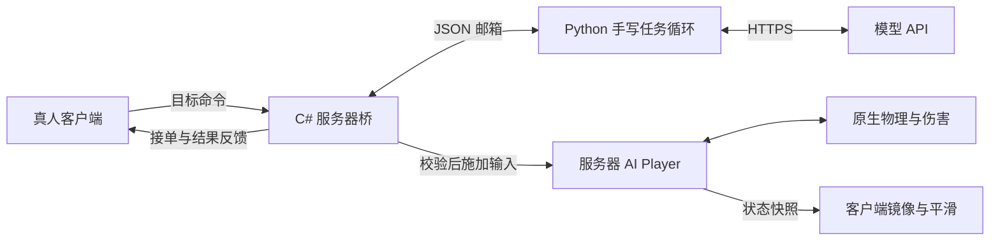

# 当前技术设计与实现

更新：2026-11-13。本文描述当前职责；验收以 [集中清单](acceptance-checklist.md) 和 [验证记录](validation.md) 为准，单人阶段报告保留历史范围。

多人已接入服务器权威接触伤害／死亡／软核重生，以及常驻 Python 宿主的中文短目标。生成者通过 `/tpamp goal` 下单，服务器经文件邮箱交给宿主，宿主仅能下发受目标身份约束的左右短移动和停止；反馈经 ModPacket 回到该真人客户端。动作同时匹配世界、AI generation、连接 token、宿主 session、目标 id 和停止版本。客户端镜像只负责显示。原生主动攻击／挖掘适配仍限单人，不能据此开放多人命令。

`MultiplayerAgentBridge` 负责多人目标邮箱、身份校验、动作白名单及结果过滤；`MultiplayerProbe` 负责真人控制归属、连接对象校验和网络回显；`MultiplayerGoalAcceptance` 仅在显式开发模式下自动驱动替换／停止验收，不参与普通游戏决策。Python 仍复用同一个手写 loop，以模式选择观察、提示词和工具白名单；OS 文件锁保证单邮箱单宿主，单个在途模型请求避免快速替换时积累线程。详见 [多人探针](multiplayer-probe.md)。

## 多人角色与显示

`Commands/MultiplayerProbeCommand.cs` 提供独立 `/tpamp` 命令，经 Mod.HandlePacket 转交 `Common/MultiplayerProbe.cs`。服务器执行生成、限时移动、队伍和清理，每 6 tick 向客户端发送位置／速度／方向／队伍／生命；客户端创建显示镜像。服务器对虚拟槽位跳过无连接清理分支，不暂时切换 active；发往该空连接槽位的原生聊天消息被过滤。IL 分支按运行时 ILLabel 处理，模式变化则拒绝加载，需检查新 tML 版本。

当前一名真人场景已通过基础角色、平滑、清理、接触受伤／死亡／重生及中文短目标；AI不是实际网络客户端。第二真人、存活服务器断线和占槽冲突仍待验证。`/tpa` 命令入口仍限单人；JSON 邮箱按模式分工，并非全部只支持单人。命令与证据见 [多人探针](multiplayer-probe.md)。

## 基座与职责

C# 12／.NET 8的独立tModLoader模组负责角色和原生连续控制；Python标准库Agent负责HTTPS模型请求与任务循环。global.json 指定兼容的.NET 8 SDK选择规则，本地配置为`.local/tModLoader`。不依赖第三方伙伴模组、数据库、完整寻路或Agent框架；Cheat Sheet／HERO's Mod 是默认测试辅助。

| 文件 | 当前职责 |
| --- | --- |
| Common/DemoPlayerSystem.cs | 独立Player槽位、生命周期、输入、跨坎／恢复、库存与敌怪观察、战斗事件；同文件DemoUpdateProbe补接触伤害并计更新数 |
| Common/GroundNavigation.cs | 水平目标、home／活动边界、刹停判断、目标状态和sequence；不计算完整路径 |
| Common/LocalTerrain.cs | 局部碰撞探测和17×11格观察 |
| Common/NativeMining.cs | 普通挥动镐原生接入、范围／保护条件、候选、原生PickTile前后事件和取消 |
| Common/NativeCombat.cs | 起手／近战／致死归属检查的有限适配，以及软核自动重生 |
| Commands/DemoCommand.cs | /tpa参数、单人限制、明确接受或拒绝；操作真人与受控AI分离；`/tpa goal`把目标文本交给宿主邮箱；stop／remove清掉待发目标 |
| Common/LocalTestBridge.cs | -tpatest下的文件请求、停止优先通道、版本检查与状态；`/tpa goal`先RequestStop抢占、按入队时的stopRevision／worldSession发布goal（新目标覆盖待发目标），按id过滤过期结果，并用host-ready心跳判断宿主是否在线；复用命令层，不开网络端口 |
| Common/MultiplayerProbe.cs、DisplaySync.cs | 真人 Player／Socket 控制归属，服务器命令／反馈包、客户端镜像和有界平滑；不复制怪物选敌逻辑 |
| Common/MultiplayerAgentBridge.cs | 显式只读／动作开关、目标收发、身份校验、短移动白名单、回执过滤 |
| Common/MultiplayerGoalAcceptance.cs、agent/acceptance.py | 有界开发验收：真实接单后替换、移动开始后停止、观察60tick；不参与普通决策 |
| Common/WorldSession.cs | 世界会话标识；进世界生成、退出清空，恢复对账据此拒绝跨世界恢复 |
| Common/NativeChatInput.cs、EnterDiagnostics.cs | 开发输入诊断及固定聊天探针，不是任意文本输入工具 |
| agent/run.py、agent/prompts/ | 模型工具白名单、顺序等待、实际结果判定、取消、有限预算、报告与能力／目标提示；常驻宿主的心跳线程与目标身份绑定 |
| scripts/ | 构建、独立启动、请求入口和相关检查；不负责给已加载程序集热更新 |

## 角色与更新

spawn在真人附近查找无实心碰撞位置，创建有独立生命／背包的Player并放入空闲槽位，保存槽位原对象。除生成／原生重生外不直接设置位置；引擎负责更新和绘制，不再调用第二次Player.Update，不切换Main.myPlayer。

PreUpdatePlayers先清除旧输入，再施加本次移动、跳跃、向下或物品使用意图。时长按60ticks/模拟秒换算，暂停不消耗模拟时间。普通手动新动作替换旧动作；普通jump保留水平移动，方向jump组合移动与跳跃。

低矮障碍检查上移1–5格的空间并自动施加跳跃；持续无进展时最多两次恢复跳跃，仍失败给明确blockedReason。原生重力／碰撞决定实际能否通过，不保证高墙、低顶、平台和洞穴通行。

stop取消主动输入，不强制速度归零或冻结动画。remove／退出世界恢复仍由AI占据的槽位，清除范围和角色；不持久化AI。死亡清旧动作，软核AI原生倒计时到零后，有限补调FindSpawn、CheckSpawn、Spawn(ReviveFromDeath)，保留同一对象和背包；remove取消该对象的重生资格。

## 单人目标移动与边界

GroundNavigation只管水平世界像素X（actor.x），不接收方块列号。goto／home默认最多10秒，误差8像素内、落地且低速才arrived。依据当前水平速度与runSlowdown提前释放输入，利用原生摩擦减速；受阻、超时、取消与到达分开，本次sequence防止旧结果被误用。

range 1–100格以当前AI的X建立home和左右边界，off解除；设置会取消旧任务并递增停止版本。旧定时移动和方向跑跳也受本地边界约束，范围外目标拒绝；普通stop不清范围，移除／退出清除。模型白名单不开放range；探索模板由宿主在开始时建立25格范围。

这是主动输入边界，不是物理墙。击退／重生可能出界，outsideBounds反映实际状态，向内返回仍允许。到达后不持续守位；总结时世界还在变化，不能用历史arrived替代最新位置。

## 原生物品与结果

主动攻击的起手／近战归属适配仍限单人和已支持物品。接触受伤／致死／软核重生已有限放行服务器权威 Actor，要求当前对象／槽位匹配且无真人连接占用；客户端镜像不结算。DemoUpdateProbe 为被跳过的本地交互段补调原生 Update_NPCCollision，不复制伤害公式、命中框或直接扣血。11月13日在 tML 2026.9.3.1 加载和实测通过，不保证其他版本兼容。

挖掘走ItemCheck_Inner → ItemCheck_OwnerOnlyCode → ItemCheck_UseMiningTools → PickTile；仅在本AI挖掘激活时放行必要归属分支。tileTargetX/Y是共享字段，范围检查和挖掘调用内短暂替换、finally恢复；不动真人鼠标。复用原生冷却、强度与方块规则，CanKillTile=false的支撑等目标不推荐且立即拒绝。

原生PickTile前后记录坐标、工具、类型／存在性和broken。草地变泥土不算移除，移除不算拾取。库存可观察并选择；equip wood／iron／pick只在开发模式发测试物资，普通初始装备尚未接入。木剑／铁阔剑攻击已适配；普通挥动镐可用，斧／锤／钻头等未交付。

## Agent与开发入口

Python通过request.json及唯一response-id.json与游戏线程交换。单人 stop.json 独立优先处理；多人动作和带目标身份的停止走 request.json，真人 `/tpamp stop` 直接在服务器取消。stopRevision变化取消旧任务，旧收尾也不能覆盖新任务。多人请求标 agentMode，主菜单的单人桥不消费。

API请求在网络线程运行，游戏请求由宿主串行处理。等待API时仍检查取消；迟到响应不继续动作，但不承诺服务端请求被取消或不计费。工具仅开放受限命令，不接受任意shell或代码。

game_actions逐条等输入／当前动画结束，再下发后续动作，按tick而非仅墙钟等待。被拒／受阻等情况停止本批后续动作；goto／home和挖掘各核对本次实际证据。自定义自然语言目标没有通用全游戏自动验收器；model_finished仅表示模型正常结束，任务目标仍需事实核对。

单人历史实测失焦时入口／世界可能停止响应；不能直接套到多人服务器。宿主区分暂停、tick冻结、请求未执行、结果未知与取消，恢复先对账、不盲目重放；未获stop确认保留stop_error。完整失焦恢复仍待实机，短目标成功不代表长期后台游玩已支持。

## 观察与边界

观察包括AI／真人位置、生命、输入、工具、库存、导航、局部地形／矿物候选、附近480像素最近8个敌怪和有界事件。敌怪位置会过时、slot可能复用，列表不覆盖所有弹幕；候选canKill=true也不保证工具强度足够。

当前一真人＋一个AI，单活动短目标，尚非完整玩法同步。正常初始装备、多人主动攻击、可靠拾取、完整寻路、跟随／守位、合成和持久化仍未交付。反编译调查只留被忽略的.local/research，不提交游戏源码／二进制；本项目新增代码使用MIT。
